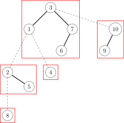

## 引入

前置知识：[树链剖分](../graph/hld.md)

由于树链剖分的时间复杂度为 $O(n\log^2 n)$，而我们熟知的 LCT 虽然时间复杂度为 $O(n\log n)$，但常数较大，可能比树链剖分还慢．那么有什么既是 $O(n\log n)$ 的，常数又相对较小的方法呢？这个时候全局平衡二叉树就出现了．

全局平衡二叉树实际上是一个二叉树森林，其中的每棵二叉树维护一条重链．但是这个森林里的二叉树又互有联系，其中每个二叉树的根连向这个重链链头的父亲，就像 LCT 中一样．但全局平衡二叉树是静态树，区别于 LCT，建成后树的形态不变．

全局平衡二叉树是一种可以处理树上链修改/查询的数据结构，可以做到：

-   $O(\log n)$ 一条链整体修改．
-   $O(\log n)$ 一条链整体查询．
-   $O(\log n)$ 求最近公共祖先，子树修改，子树查询等，这些复杂度和重链剖分是一样的．

## 主要性质

1.  全局平衡二叉树由很多棵二叉树通过轻边连起来组成，每一棵二叉树维护了原树的一条重链，其中序遍历的顺序就是这条重链深度单调递增的顺序．每个节点都仅出现在一棵二叉树中．
2.  边分为重边和轻边，重边是包含在二叉树中的边，维护的时候就像正常维护二叉树一样，记录左右儿子和父节点．轻边从一棵二叉树的根节点指向它所对应的重链顶端节点的父节点．轻边维护的时候 "认父不认子"，即只能从子节点访问到父节点，不能反过来．注意，全局平衡二叉树中的边和原树中的边没有对应关系．
3.  算上重边和轻边，全局平衡二叉树的高度是 $O(\log n)$ 级别的．这条是保证全局平衡二叉树时间复杂度的性质．

下面是一个全局平衡二叉树建树的例子．第一张图是原树，以节点 1 为根节点．实线是重边．


第二张图是建出来的全局平衡二叉树，其中虚线是轻边，实线是重边，每一棵二叉树用红圈表示．



## 建树

首先是像普通重链剖分一样，一次 DFS 求出每个节点的重儿子．然后从根开始，找到根节点所在的重链，对于这些点的轻儿子递归建树，并连上轻边．然后我们需要给重链上的点建一棵二叉树．我们先把重链上的点存到数组里，求出每个点轻儿子的子树大小之和加一（即该点本身所贡献的 size）．然后我们按照这个求出这条重链的加权中点，把它作为二叉树的根，两边递归建树，并连上重边．

代码如下：

???+ note "实现"
    ```cpp
    --8<-- "docs/ds/code/global-bst/global-bst_1.cpp:example63"
    ```

由代码可以看出建树的时间复杂度是 $O(n\log n)$．接下来我们可以证明树高是 $O(\log n)$ 的：考虑从任意一个点跳父节点到根．跳轻边就相当于在原树中跳到另一条重链，由重链剖分的性质可得跳轻边最多 $O(\log n)$ 条；因为建二叉树的时候根节点找的是算轻儿子的加权中点，那么跳一次重边算上轻儿子的 size 至少翻倍，所以跳重边最多也是 $O(\log n)$ 条．整体树高就是 $O(\log n)$ 的．

## 查询

以上就是关于全局平衡二叉树的部分．剩下关于链修改和链查询的操作方法相对简单，只需要从要操作的点出发，一直跳跃到根节点．要操作某个点所在的重链上比它深度小的所有点，本质上等同于在这条重链的二叉树中操作目标节点左侧的所有节点．这些操作可以分解成一系列子树操作，与普通二叉树的维护方法类似，其中涉及到维护子树和以及打子树标记．在这一过程中，使用的是标记永久化．也可以用 pushdown 来打标记，用 pushup 维护子树和，不过这种方式可能相对复杂，因为通常情况下，处理二叉树是自上而下进行操作，但在这里，需要首先确定跳跃路径，然后再从上到下进行 pushdown，可能导致常数较大．

代码如下：

???+ note "实现"
    ```cpp
    --8<-- "docs/ds/code/global-bst/global-bst_1.cpp:example64"
    ```

此外，对于子树操作，就是要考虑轻儿子的，需要再维护一个包括轻儿子的子树和、子树标记，可以去做 "[P3384【模板】轻重链剖分](https://www.luogu.com.cn/problem/P3384)"．

## 例题

??? note "[P4751【模板】"动态 DP"& 动态树分治（加强版）](https://www.luogu.com.cn/problem/P4751)"
    ```cpp
    --8<-- "docs/ds/code/global-bst/global-bst_2.cpp"
    ```

## 参考

[P4211 \[LNOI2014\] LCA | 全局平衡二叉树](https://www.luogu.com.cn/blog/nederland/globalbst)
