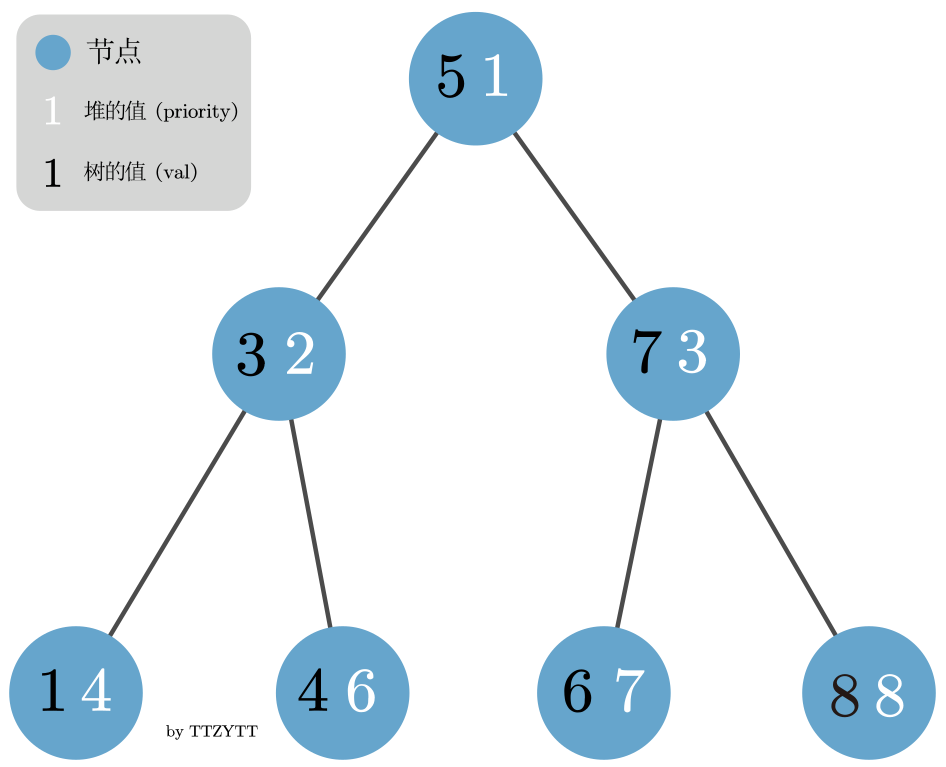
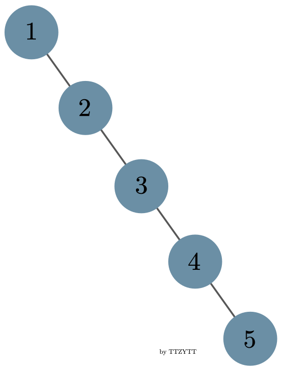
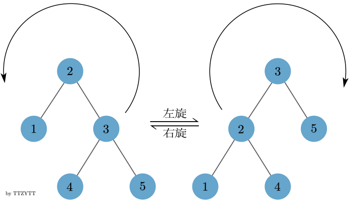
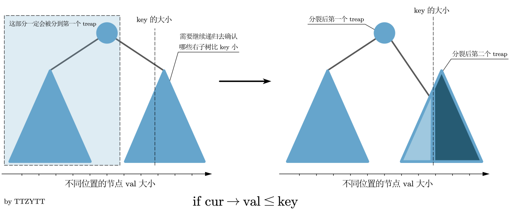
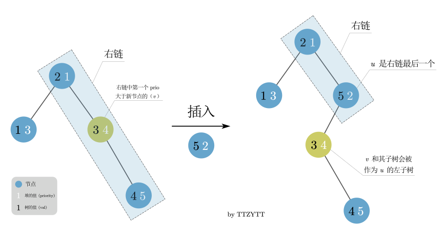
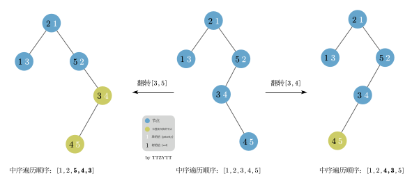

author: Dev-XYS, ttzytt, Sora233, qwqAutomaton

前置知识：[朴素二叉搜索树](./bst.md)，[堆基础](./heap.md)．

## 简介

Treap（树堆）是一种 **弱平衡** 的 **二叉搜索树**．

Treap 的结点除了被维护的 **权值**（$\textit{val}$）之外，还附加了一个随机的 **优先级**（$\textit{priority}$）．其中，权值满足二叉搜索树性质，优先级满足堆性质（小根堆或大根堆）．

其中，二叉搜索树的性质是指：

-   左子树所有节点的权值（$\textit{val}$）比父节点小．
-   右子树所有节点的权值（$\textit{val}$）比父节点大．

堆的性质是：

-   子节点优先级（$\textit{priority}$）比父节点大或小（取决于是小根堆还是大根堆）．

不难看出，如果用的是同一个值，那么这两种数据结构在组合后会变成一条链，所以我们再在搜索树的基础上，引入一个给堆的值 $\textit{priority}$．对于 $\textit{val}$ 值，我们维护搜索树的性质，对于 $\textit{priority}$ 值，我们维护堆的性质．其中 $\textit{priority}$ 这个值是随机给出的．

下图就是一个 Treap 的例子（这里使用的是小根堆，即根节点的优先级最小）．



那我们为什么需要大费周章的去让这个数据结构符合树和堆的性质，并且随机给出堆的值呢？

要理解这个，首先需要理解朴素二叉搜索树的问题．在给朴素搜索树插入一个新节点时，我们需要从这个搜索树的根节点开始递归，如果新节点比当前节点小，那就向左递归，反之亦然．

最后当发现当前节点没有子节点时，就根据新节点的值的大小，让新节点成为当前节点的左或右子节点．

如果插入结点的权值是随机的（换言之，是随机插入的），那这个朴素搜索树的高度较小（接近 $\log n$，其中 $n$ 为结点数），而每一层的节点数较多，即它的形状会非常的「胖」．上图的 Treap 就是一个例子．因此此时的任意操作复杂度都将会是 $O(\log n)$ 左右．

不过，这只是在随机情况下的复杂度，如果我们按照下面这个非常有序的顺序给一个朴素的搜索树插入节点：

```plain
1 2 3 4 5
```

那么这棵树将会退化成链，即变得非常「瘦长」（每次插入的节点都比前面的大，所以都被安排到右子节点了）：



不难看出，查询的复杂度也从 $O(\log n)$ 变成了 $O(n)$.

而 treap 为了解决这个问题、达到一个较为「平衡」的状态，通过维护随机的优先级满足堆性质，「打乱」了节点的插入顺序，从而让二叉搜索树达到了理想的复杂度，避免了退化成链的问题．

## Treap 复杂度的证明

由于 treap 各种操作的复杂度都和所操作的节点的深度有关，我们首先证明，所有节点的期望深度都是 $O(\log n)$．

### 记号约定

为了方便表述，我们约定：

-   $n$ 是节点个数．
-   Treap 节点中满足二叉搜索树性质的称为 **权值**，满足堆性质的（也就是随机的）称为 **优先级**．不妨设优先级满足小根堆性质．
-   $x_k$ 表示权值第 $k$ 小的节点．
-   $X_{i,j}$ 表示集合 $\{x_i,x_{i+1},\cdots,x_{j-1},x_j\}$，即按权值升序排列后第 $i$ 个到第 $j$ 个的节点构成的集合．
-   $\operatorname{dep}(x)$ 表示节点 $x$ 的深度．规定根节点的深度是 $0$．
-   $Y_{i,j}$ 是一个指示器随机变量，当 $x_i$ 是 $x_j$ 的祖先时值为 $1$，否则为 $0$．特别地，$Y_{i,i}=0$．
-   $\Pr(A)$ 表示事件 $A$ 发生的概率．

### 节点期望深度的证明

由于节点 $x_i$ 的深度等于它祖先的个数，因此有

$$
\operatorname{dep}(x_i)=\sum_{k=1}^nY_{k,i}.
$$

那么根据期望的线性性，有

$$
E(\operatorname{dep}(x_i))=E\left(\sum_{k=1}^nY_{k,i}\right)=\sum_{k=1}^nE(Y_{k,i}).
$$

由于 $Y_{k,i}$ 是指示器随机变量，它的期望就等于它为 $1$ 的概率，因此

$$
E(\operatorname{dep}(x_i))=\sum_{k=1}^n\Pr(Y_{k,i}=1).
$$

我们先证明引理：$Y_{i,j}=1$ 当且仅当 $x_i$ 的优先级是 $X_{i,j}$ 中最小的．

??? note "引理的证明"
    考虑分类讨论 $x_i$ 和 $x_j$ 的情况．
    
    1.  若 $x_i$ 是根节点：由于优先级满足小根堆性质，$x_i$ 的优先级最小，并且对于任意的 $x_j$，$x_i$ 都是 $x_j$ 的祖先．
    2.  若 $x_j$ 是根节点：同理，$x_j$ 优先级最小，因此 $x_i$ 不是 $X_{i,j}$ 中优先级最小的；同时 $x_i$ 也不是 $x_j$ 的祖先．
    3.  若 $x_i$ 和 $x_j$ 在根节点的两个子树中（一左一右），那么根节点 $r\in X_{i,j}$. 因此 $x_i$ 的优先级不可能是 $X_{i,j}$ 中最小的（因为根节点的比它小）．同时，由于 $x_i$ 和 $x_j$ 分属两个子树，$x_i$ 也不是 $x_j$ 的祖先．
    4.  若 $x_i$ 和 $x_j$ 在根节点的同一个子树中，此时可以将这个子树单独拿出来作为一棵新的 treap，递归进行上面的证明即可．

那么根据引理，深度的期望可以转化成

$$
E(\operatorname{dep}(x_i))=\sum_{k=1}^n\Pr(x_k=\min X_{i,k}\land k\neq i).
$$

又因为节点的优先级是随机的，我们假定集合 $X_{i,j}$ 中任何一个节点的优先级最小的概率都相同，那么

$$
\begin{aligned}
E(\operatorname{dep}(x_i))&=\sum_{k=1}^n\Pr(x_k=\min X_{i,k}\land k\neq i)\\
&=\sum_{k=1}^{n}\Pr(x_k=\min X_{i,k})-1\\
&=\sum_{k=1}^n\dfrac{1}{|i-k|+1}-1\\
&=\sum_{k=1}^{i-1}\dfrac{1}{i-k+1}+\sum_{k=i+1}^n\dfrac{1}{k-i+1}\\
&=\sum_{j=2}^i\dfrac 1j+\sum_{j=2}^{n-i+1}\dfrac 1j\\
&\le 2\sum_{j=2}^n\dfrac 1j < 2\sum_{j=2}^n\int_{j-1}^j\dfrac 1x\mathrm dx\\
&=2\int_1^n\dfrac 1x\mathrm dx=2\ln n=O(\log n).
\end{aligned}
$$

因此每个节点的期望深度都是 $O(\log n)$．

而朴素的二叉搜索树的操作的复杂度均是 $O(h)$，同时 treap 维护堆性质的复杂度也是 $O(h)$ 的，因此 treap 各种操作的期望复杂度都是 $O(\log n)$．

???+ note "期望复杂度的感性理解"
    首先，我们需要认识到一个节点的 $\textit{priority}$ 属性是和它所在的层数有直接关联的．再回忆堆的性质：
    
    -   子节点值（$\textit{priority}$）比父节点大或小（取决于是小根堆还是大根堆）
    
    我们发现层数低的节点，比如整个树的根节点，它的 $\textit{priority}$ 属性也会更小（在小根堆中）．并且，在朴素的搜索树中，先被插入的节点，也更有可能会有比较小的层数．我们可以把这个 $\textit{priority}$ 属性和被插入的顺序关联起来理解，这样，也就理解了为什么 treap 可以把节点插入的顺序通过 $\textit{priority}$ 打乱．

给 treap 插入新节点时，需要同时维护树和堆的性质．其中，搜索树的性质可以在插入时维护，而堆性质的维护则有两种处理方法，分别是旋转和分裂、合并．使用这两种方法的 treap 被分别称为 **旋转 treap** 和 **无旋 treap**．

## 旋转 treap

**旋转 treap** 维护平衡的方式为旋转，和 AVL 树的旋转操作类似，分为 **左旋** 和 **右旋**．即在满足二叉搜索树的条件下根据堆的优先级对 treap 进行平衡操作．

旋转 treap 在做普通平衡树题的时候，是所有平衡树中常数较小的．

下面的讲解中的代码用指针实现了旋转 treap，文末附有数组形式的完整实现．

???+ info "Info"
    代码中的 `rank` 代表前面讲的优先级（$\textit{priority}$ 属性），该属性满足的是小根堆性质．

### 节点结构

```cpp
--8<-- "docs/ds/code/treap/treap_1.cpp:example178"
```

### 旋转

旋转操作是 treap 的一个非常重要的操作，主要用来在保持 treap 树性质的同时，调整不同节点的层数，以达到维护堆性质的作用．

旋转操作的左旋和右旋可能不是特别容易区分，以下是两个较为明显的特点：

旋转操作的含义：

-   在不影响搜索树性质的前提下，把和旋转方向相反的子树变成根节点（如左旋，就是把右子树变成根节点）
-   不影响性质，并且在旋转过后，跟旋转方向相同的子节点变成了原来的根节点（如左旋，旋转完之后的左子节点是旋转前的根节点）

左旋和右旋操作是相互的，如下图．



```cpp
--8<-- "docs/ds/code/treap/treap_1.cpp:example179"
```

### 插入

类似普通二叉搜索树的插入，但是需要在插入的过程中通过旋转来维护优先级的堆性质．

```cpp
--8<-- "docs/ds/code/treap/treap_1.cpp:example180"
```

### 删除

主要就是分类讨论，不同的情况有不同的处理方法，删完了树的大小会有变化，要注意更新．并且如果要删的节点有左子树和右子树，就要考虑删除之后让谁来当父节点（维护 rank 小的节点在上面）．

```cpp
--8<-- "docs/ds/code/treap/treap_1.cpp:example181"
```

### 根据值查询排名

操作含义：查询以 cur 为根节点的子树中，val 这个值的大小的排名（该子树中小于 val 的节点的个数 + 1）

```cpp
--8<-- "docs/ds/code/treap/treap_1.cpp:example182"
```

### 根据排名查询值

要根据排名查询值，我们首先要知道如何判断要查的节点在树的哪个部分：

以下是一个判断方法的表：

| 左子树         | 根节点/当前节点                           | 右子树                    |
| ----------- | ---------------------------------- | ---------------------- |
| 排名 ≤ 左子树的大小 | 排名 > 左子树的大小，并且 ≤ 左子树的大小 + 根节点的重复次数 | 排名 > 左子树的大小 + 根节点的重复次数 |

注意如果在右子树，递归的时候需要对原来的 `rank` 进行处理．递归的时候就相当去查，在右子树中为这个排名的值，为了把排名转换成基于右子树的，需要把原来的 `rank` 减去左子树的大小和根节点的重复次数．

可以把所有节点想象成一个排好序的数组，或者数轴（如下），

    1 -> |左子树的节点|根节点|右子树的节点| -> n
                               ^
                               要查的排名
                         ⬇转换成基于右子树的排名
    1 -> |右子树的节点| -> n
           ^
           要查的排名

这里的转换方法就是直接把排名减去左子树的大小和根节点的重复数量．

```cpp
--8<-- "docs/ds/code/treap/treap_1.cpp:example183"
```

### 查询第一个比 val 小的节点

注意这里使用了一个类中的全局变量，`q_prev_tmp`．

这个值是只有在 val 比当前节点值大的时候才会被更改的，所以返回这个变量就是返回 val 最后一次比当前节点的值大，之后就是更小了．

```cpp
--8<-- "docs/ds/code/treap/treap_1.cpp:example184"
```

### 查询第一个比 val 大的节点

跟前一个很相似，只是大于小于号换了一下．

```cpp
--8<-- "docs/ds/code/treap/treap_1.cpp:example185"
```

## 无旋 treap

无旋 treap 的操作方式使得它天生支持维护序列、可持久化等特性．

**无旋 treap** 又称分裂合并 treap．它仅有两种核心操作，即为 **分裂** 与 **合并**．通过这两种操作，在很多情况下可以比旋转 treap 更方便的实现别的操作．下面逐一介绍这两种操作．

???+ note "注释"
    讲解无旋 treap 应当提到 **FHQ-Treap**（by 范浩强）．即可持久化，支持区间操作的无旋 Treap．更多内容请参照《范浩强谈数据结构》ppt．

### 分裂（split）

#### 按值分裂

分裂过程接受两个参数：根指针 $\textit{cur}$、关键值 $\textit{key}$．结果为将根指针指向的 treap 分裂为两个 treap，第一个 treap 所有结点的值（$\textit{val}$）小于等于 $\textit{key}$，第二个 treap 所有结点的值大于 $\textit{key}$．

该过程首先判断 $\textit{key}$ 是否小于 $\textit{cur}$ 的值，若小于，则说明 $\textit{cur}$ 及其右子树全部大于 $\textit{key}$，属于第二个 treap．当然，也可能有一部分的左子树的值大于 $\textit{key}$，所以还需要继续向左子树递归地分裂．对于大于 $\textit{key}$ 的那部分左子树，我们把它作为 $\textit{cur}$ 的左子树，这样，整个 $\textit{cur}$ 上的节点都是大于 $\textit{key}$ 的．

相应的，如果 $\textit{key}$ 大于等于 $\textit{cur}$ 的值，说明 $\textit{cur}$ 的整个左子树以及其自身都小于等于 $\textit{key}$，属于分裂后的第一个 treap．并且，$\textit{cur}$ 的部分右子树也可能有部分小于等于 $\textit{key}$，因此我们需要继续递归地分裂右子树．把小于等于 $\textit{key}$ 的那部分作为 $\textit{cur}$ 的右子树，这样，整个 $\textit{cur}$ 上的节点都小于等于 $\textit{key}$．

下图展示了 $\textit{cur}$ 的值小于等于 $\textit{key}$ 时按值分裂的情况．[^ref1]



```cpp
--8<-- "docs/ds/code/treap/treap_2.cpp:example186"
```

#### 按排名分裂

比起按值分裂，这个操作更像是旋转 treap 中的根据排名（某个节点的排名是树中所有小于此节点值的节点的数量 $+ 1$）查询值：

此函数接受两个参数，节点指针 $\textit{cur}$ 和排名 $\textit{rk}$，返回分裂后的三个 treap．

其中，第一个 treap 中每个节点的排名都小于 $\textit{rk}$，第二个的排名等于 $\textit{rk}$，并且第二个 treap 只有一个节点（不可能有多个等于的，如果有的话会增加 `Node` 结构体中的 `cnt`），第三个则是大于．

此操作的重点在于判断排名和 $\textit{cur}$ 相等的节点在树的哪个部分，这也是旋转 treap 根据排名查询值操作时的重要部分，在前文有非常详细的解释，这里不过多讲解．

并且，此操作的递归部分和按值分裂也非常相似，这里不赘述．

```cpp
--8<-- "docs/ds/code/treap/treap_2.cpp:example187"
```

### 合并（merge）

合并过程接受两个参数：左 treap 的根指针 $\textit{u}$、右 treap 的根指针 $\textit{v}$．必须满足 $\textit{u}$ 中所有结点的值小于等于 $\textit{v}$ 中所有结点的值．一般来说，我们合并的两个 treap 都是原来从一个 treap 中分裂出去的，所以不难满足 $\textit{u}$ 中所有节点的值都小于 $\textit{v}$

在旋转 treap 中，我们借助旋转操作来维护 $\textit{priority}$ 符合堆的性质，同时旋转时还不能改变树的性质．在无旋 treap 中，我们用合并达到相同的效果．

因为两个 treap 已经有序，所以我们在合并的时候只需要考虑把哪个树「放在上面」，把哪个「放在下面」，也就是需要判断将哪个一个树作为子树．显然，根据堆的性质，我们需要把 $\textit{priority}$ 小的放在上面（这里采用小根堆）．

同时，我们还需要满足搜索树的性质，所以若 $\textit{u}$ 的根结点的 $\textit{priority}$ 小于 $\textit{v}$ 的，那么 $\textit{u}$ 即为新根结点，并且 $\textit{v}$ 因为值比 $\textit{u}$ 更大，应与 $\textit{u}$ 的右子树合并；反之，则 $\textit{v}$ 作为新根结点，然后因为 $u$ 的值比 $\textit{v}$ 小，与 $v$ 的左子树合并．

```cpp
--8<-- "docs/ds/code/treap/treap_2.cpp:example188"
```

### 插入

在无旋 treap 中，插入，删除，根据值查询排名等基础操作既可以用普通二叉查找树的方法实现，也可以用分裂和合并来实现．通常来说，使用分裂和合并来实现更加简洁，但是速度会慢一点[^ref2]．为了帮助更好的理解无旋 treap，下面的操作全部使用分裂和合并实现．

在实现插入操作时，我们利用了分裂操作的一些性质．也就是值小于等于 $\textit{val}$ 的节点会被分到第一个 treap．

所以，假设我们根据 $\textit{val}$ 分裂当前这个 treap．会有下面两棵树，并符合以下条件：

$$
\begin{aligned}
T_1 &\le val\\
T_2 &> val
\end{aligned}
$$

其中 $T_1$ 表示分裂后所有被分到第一个 treap 的节点的集合，$T_2$ 则是第二个．

如果我们再按照 $\textit{val} - 1$ 继续分裂 $T_1$，那么会产生下面两棵树，并符合以下条件：

$$
\begin{gathered}
T_{1\ \text{left}} \le val - 1\\
T_{1\ \text{right}} > val - 1 \ \And \ T_{1\ \text{right}} \le val
\end{gathered}
$$

其中 $T_{1\ \text{left}}$ 表示 $T_1$ 分裂后所有被分到第一个 treap 的节点的集合，$T_{1\ \text{right}}$ 则是第二个．并且上面的式子中，后半部分的 $\And \ T_{1\ \text{right}} \le val$ 来自于 $T_1$ 所符合的条件 $T_1 \le val$．

不难发现，只要 $\textit{val}$ 和节点的值是一个整数（大多数使用场景下会使用整数）那么符合 $T_{1\ \text{right}}$ 条件的节点只有一个，也就是值等于 $\textit{val}$ 的节点．

在插入时，如果我们发现符合 $T_{1\ \text{right}}$ 的节点存在，那就可以直接增加重复次数，否则，就新开一个节点．

注意把树分裂好了还需要用合并操作把它「粘」回去，这样下次还能继续使用．并且，还需要注意合并操作的参数顺序是有要求的，第一个树的所有节点的值都需要小于第二个．

```cpp
--8<-- "docs/ds/code/treap/treap_2.cpp:example189"
```

### 删除

删除操作也使用和插入操作相似的方法，找到值和 $\textit{val}$ 相等的节点，并且删除它．

```cpp
--8<-- "docs/ds/code/treap/treap_2.cpp:example190"
```

### 根据值查询排名

排名是比这个值小的节点的数量 $+ 1$，所以我们根据 $\textit{val} - 1$ 分裂当前树，那么分裂后的第一个树就符合：

$$
T_1 \le val - 1
$$

如果树的值和 $\textit{val}$ 为整数，那么 $T_1$ 就包含了所有值小于 $\textit{val}$ 的节点．

```cpp
--8<-- "docs/ds/code/treap/treap_2.cpp:example191"
```

### 根据排名查询值

调用 `split_by_rk()` 函数后，会返回分裂好的三个 treap，其中第二个只包含一个节点，它的排名等于 $\textit{rk}$，所以我们直接返回这个节点的 $\textit{val}$．

```cpp
--8<-- "docs/ds/code/treap/treap_2.cpp:example192"
```

### 查询第一个比 val 小的节点

可以把这个问题转化为，在比 $\textit{val}$ 小的所有节点中，找出排名最大的．我们根据 $\textit{val}$ 来分裂这个 treap，返回的第一个 treap 中的节点的值就全部小于 $\textit{val}$，然后我们调用 `qval_by_rank()` 找出这个树中值最大的节点．

```cpp
--8<-- "docs/ds/code/treap/treap_2.cpp:example193"
```

### 查询第一个比 val 大的节点

和上个操作类似，可以把这个问题转化为，在比 $\textit{val}$ 大的所有节点中，找出排名最小的．那么根据 $\textit{val}$ 分裂后，返回的第二个 treap 中的所有节点的值就大于 $\textit{val}$．

然后我们去查询这个树中排名为 $1$ 的节点（也就是值最小的节点）的值，就可以成功查到第一个比 $\textit{val}$ 大的节点．

```cpp
--8<-- "docs/ds/code/treap/treap_2.cpp:example194"
```

### 建树（build）

将一个有 $n$ 个节点的序列 $\{a_n\}$ 转化为一棵 treap．

可以依次暴力插入这 $n$ 个节点，每次插入一个权值为 $v$ 的节点时，将整棵 treap 按照权值分裂成权值小于等于 $v$ 的和权值大于 $v$ 的两部分，然后新建一个权值为 $v$ 的节点，将两部分和新节点按从小到大的顺序依次合并，单次插入时间复杂度 $O(\log n)$，总时间复杂度 $O(n\log n)$．

在某些题目内，可能会有多次插入一段有序序列的操作，这是就需要在 $O(n)$ 的时间复杂度内完成建树操作．

方法一：在递归建树的过程中，每次选取当前区间的中点作为该区间的树根，并对每个节点钦定合适的优先值，使得新树满足堆的性质．这样能保证树高为 $O(\log n)$．

方法二：在递归建树的过程中，每次选取当前区间的中点作为该区间的树根，然后给每个节点一个随机优先级．这样能保证树高为 $O(\log n)$，但不保证其满足堆的性质．这样也是正确的，因为无旋式 treap 的优先级是用来使 `merge` 操作更加随机一点，而不是用来保证树高的．

方法三：观察到 treap 是笛卡尔树，利用笛卡尔树的 $O(n)$ 建树方法即可，用单调栈维护右链即可．

### 无旋 treap 的区间操作

#### 建树

无旋 treap 相比旋转 treap 的一大好处就是可以实现各种区间操作，下面我们以文艺平衡树的 [模板题](https://loj.ac/problem/105) 为例，介绍 treap 的区间操作．

> 您需要写一种数据结构（可参考题目标题），来维护一个有序数列．
>
> 其中需要提供以下操作：翻转一个区间，例如原有序序列是 $5\ 4\ 3\ 2\ 1$，翻转区间是 $[2,4]$ 的话，结果是 $5\ 2\ 3\ 4\ 1$．
> 对于 $100\%$ 的数据，$1 \le n$（初始区间长度）$m$（翻转次数）$\le 10^5$

在这道题目中，我们需要实现的是区间翻转，那么我们首先需要考虑如何建树，建出来的树需要是初始的区间．

我们只需要把区间的下标依次插入 treap 中，这样在中序遍历（先遍历左子树，然后当前节点，最后右子树）时，就可以得到这个区间[^ref3]．

我们知道在朴素的二叉查找树中按照递增的顺序插入节点，建出来的树是一个长链，按照中序遍历，自然可以得到这个区间．

<div align=center>
  
</div>

如上图，按照 $1\ 2\ 3\ 4\ 5$ 的顺序给朴素搜索树插入节点，中序遍历时，得到的也是 $1\ 2\ 3\ 4\ 5$．

但是在 treap 中，按增序插入节点后，在合并操作时还会根据 $\textit{priority}$ 调整树的结构，在这样的情况下，如何确保中序遍历一定能正确的输出呢？

可以参考 [笛卡尔树的单调栈建树方法](./cartesian-tree.md) 来理解这个问题．

设新插入的节点为 $\textit{u}$．

首先，因为是递增地插入节点，每一个新插入的节点肯定会被连接到 treap 的右链（即从根结点一直往右子树走，经过的结点形成的链）上．

从根节点开始，右链上的节点的 $\textit{priority}$ 是递增的（小根堆）．那我们可以找到右链上第一个 $\textit{priority}$ 大于 $\textit{u}$ 的节点，我们叫这个节点 $\textit{v}$，并把这个节点换成 $\textit{u}$．

因为 $\textit{u}$ 一定大于这个树上其他的全部节点，我们需要把 $\textit{v}$ 以及它的子树作为 $\textit{u}$ 的左子树．并且此时 $\textit{u}$ 没有右子树．

可以发现，中序遍历时 $\textit{u}$ 一定是最后一个被遍历到的（因为 $\textit{u}$ 是右链中的最后一个，而中序遍历中，右子树是最后被遍历到的）．

下图是一个 treap 根据递增顺序插入 $1 \sim 5$ 号节点时，插入 $5$ 号节点时的变化，可以用这张图更好的理解按照增序插入的过程．



#### 区间翻转

翻转 $[l, r]$ 这个区间时，基本思路是将树分裂成 $[1, l - 1],\ [l, r],\ [r + 1, n]$ 三个区间，再对中间的 $[l, r]$ 进行翻转[^ref3]．

翻转的具体操作是把区间内的子树的每一个左，右子节点交换位置．如下图就展示了翻转上图中 treap 的 $[3, 4]$ 和 $[3, 5]$ 区间后的 treap．



注意如果按照这个方法翻转，那么每次翻转 $[l, r]$ 区间时，就会有 $r - l$ 个节点会被交换位置，这样频繁的操作显然不能满足 $10^5$ 的数据范围，其 $O(n \times \log_2 n)$ 的单次翻转复杂度甚至不如暴力（因为我们除了需要花线性时间交换节点外，还需要在树中花费 $O(\log_2 n)$ 的时间找到需要交换的节点）．

再观察题目要求，可以发现因为只需要最后输出操作完的区间，所以并不需要每次都真的去交换．如此一来，便可以使用线段树中常用的懒标记（lazy tag）来优化复杂度．交换时，只需要在父节点打上标记，代表这个子树下的每个左右子节点都需要交换就行了．

在线段树中，我们一般在更新和查询时下传懒标记．这是因为，在更新和查询时，我们想要更新/查询的范围不一定和懒标记代表的范围重合，所以要先下传标记，确保查到和更新后的值是正确的．

在无旋 treap 中也是一样．具体操作时我们会把 treap 分裂成前文讲到的三个树，然后给中间的树打上懒标记后合并这三棵树．因为我们想要翻转的区间和懒标记代表的区间不一定重合，所以要在分裂时下传标记．并且，分裂和合并操作会造成每个节点及其懒标记所代表的节点发生变动，所以也需要在合并前下传懒标记．

换句话说，是当树的结构发生改变的时候，当我们进行分裂或合并操作时需要改变某一个点的左右儿子信息时之前，应该下放标记，而非之后，因为懒标记是需要下传给儿子节点的，但更改左右儿子信息之后若懒标记还未下放，则懒标记就丢失了下放的对象．[^ref4]

<!-- TODO: 可以加一张图解释为什么需要在分裂和合并时下传标记 -->

以下为代码讲解，代码参考了[^ref3]．

因为区间操作中大部分操作都和普通的无旋 treap 相同，所以这里只讲解和普通无旋 treap 不同的地方．

#### 下传标记

需要注意这里的懒标记代表需要把这个树中的每一个子节点交换位置．所以如果当前节点的子节点也有懒标记，那两次翻转就抵消了．如果子节点不需要翻转，那么这个懒标记就需要继续被下传到子节点上．

```cpp
--8<-- "docs/ds/code/treap/treap_3.cpp:example195"
```

#### 分裂

注意在这个题目中，因为翻转操作，treap 中的 $\textit{val}$ 会不符合二叉搜索树的性质（见区间翻转部分的图），所以我们不能根据 $\textit{val}$ 来判断应该往左子树还是右子树递归．

所以这里的分裂跟普通无旋 treap 中的按排名分裂更相似，是根据当前树的大小判断往左还是右子树递归的，换言之，我们是按照开始时这个节点在树中的位置来判断的．

返回的第一个 treap 中节点的排名全部小于等于 $\textit{sz}$，而第二个 treap 中节点的排名则全部大于 $\textit{sz}$．

```cpp
--8<-- "docs/ds/code/treap/treap_3.cpp:example196"
```

#### 合并

唯一需要注意的是在合并前下传懒标记

```cpp
--8<-- "docs/ds/code/treap/treap_3.cpp:example197"
```

#### 区间翻转

和前面介绍的一样，分裂出 $[1, l - 1],\ [l, r],\ [r + 1, n]$ 三个区间，然后对中间的区间打上标记后再合并．

```cpp
--8<-- "docs/ds/code/treap/treap_3.cpp:example198"
```

#### 中序遍历打印

要注意在打印时要下传标记．

```cpp
--8<-- "docs/ds/code/treap/treap_3.cpp:example199"
```

## 完整代码

### 旋转 treap

#### 指针实现

??? note "完整代码"
    以下是前文讲解的代码的完整版本，是普通平衡树的模板代码．
    
    ```cpp
    --8<-- "docs/ds/code/treap/treap_5.cpp:display"
    ```

#### 数组实现

以下是 bzoj 普通平衡树模板代码，使用数组实现．

??? note "完整代码"
    ```cpp
    --8<-- "docs/ds/code/treap/treap_4.cpp"
    ```

### 无旋 treap

#### 指针实现

??? note "完整代码"
    以下是前文讲解的代码的完整版本，是普通平衡树的模板代码．
    
    ```cpp
    --8<-- "docs/ds/code/treap/treap_6.cpp:display"
    ```

### 无旋 treap 的区间操作

#### 指针实现

??? note "完整代码"
    以下是前文讲解的代码的完整版本，是文艺平衡树题目的模板代码．
    
    ```cpp
    --8<-- "docs/ds/code/treap/treap_7.cpp:display"
    ```

## 例题

[普通平衡树](https://loj.ac/problem/104)

[文艺平衡树（Splay）](https://loj.ac/problem/105)

[「ZJOI2006」书架](https://www.luogu.com.cn/problem/P2596)

[「NOI2005」维护数列](https://www.luogu.com.cn/problem/P2042)

[CF 702F T-Shirts](http://codeforces.com/problemset/problem/702/F)

## 参考资料与注释

[^ref1]: 本图的设计参考了 [维基百科 treap 词条的配图](https://en.wikipedia.org/wiki/Treap)

[^ref2]: <https://charleswu.site/archives/1051>

[^ref3]: <https://www.cnblogs.com/Equinox-Flower/p/10785292.html>

[^ref4]: <https://www.luogu.com.cn/blog/85514/fhq-treap-xue-xi-bi-ji>
