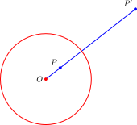
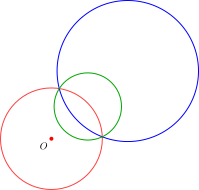
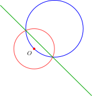

author: hyp1231, 383494

## 引入

反演变换适用于题目中存在多个圆/直线之间的相切关系的情况．利用反演变换的性质，在反演空间求解问题，可以大幅简化计算．

## 定义

给定反演中心点 $O$ 和反演半径 $R$．若平面上点 $P$ 和 $P'$ 满足：

-   点 $P'$ 在射线 $\overrightarrow{OP}$ 上
-   $|OP| \cdot |OP'| = R^2$

则称点 $P$ 和点 $P'$ 互为反演点．

## 解释

下图所示即为平面上一点 $P$ 的反演：



## 性质

1.  圆 $O$ 外的点的反演点在圆 $O$ 内，反之亦然；圆 $O$ 上的点的反演点为其自身．

2.  不过点 $O$ 的圆 $A$，其反演图形也是不过点 $O$ 的圆．

    

    -   记圆 $A$ 半径为 $r_1$，其反演图形圆 $B$ 半径为 $r_2$，则有：

        $$
        r_2 = \frac{1}{2}\left(\frac{1}{|OA| - r_1} - \frac{1}{|OA| + r_1}\right) R^2
        $$

    ???+ note "证明"
        
        
        根据反演变换定义：
        
        $$
        \begin{aligned}
        |OC|\cdot|OC'| &= (|OA|+r_1)\cdot(|OB|-r_2) = R^2 \\
        |OD|\cdot|OD'| &= (|OA|-r_1)\cdot(|OB|+r_2) = R^2
        \end{aligned}
        $$
        
        消掉 $|OB|$，解方程即可．

    -   记点 $O$ 坐标为 $(x_0, y_0)$，点 $A$ 坐标为 $x_1, y_1$，点 $B$ 坐标为 $x_2, y_2$，则有：

        $$
        \begin{aligned}
        x_2 &= x_0 + \frac{|OB|}{|OA|} (x_1 - x_0) \\
        y_2 &= y_0 + \frac{|OB|}{|OA|} (y_1 - y_0)
        \end{aligned}
        $$

        其中 $|OB|$ 可在上述求 $r_2$ 的过程中计算得到．

3.  过点 $O$ 的圆 $A$，其反演图形是不过点 $O$ 的直线．因为圆 $A$ 上无限接近点 $O$ 的一点，其反演点离点 $O$ 无限远．

    

4.  两个图形相切且存在不为点 $O$ 的切点，则他们的反演图形也相切．

## 例题

### [「ICPC 2013 杭州赛区」Problem of Apollonius](https://acm.hdu.edu.cn/showproblem.php?pid=4773)

#### 题目大意

求过两圆外一点，且与两圆相切的所有的圆．

#### 解法

首先考虑解析几何解法，似乎很难求解．

考虑以需要经过的点为反演中心进行反演（反演半径任意），所求的圆的反演图形是一条直线（应用性质 $3$），且与题目给出两圆的反演图形（性质 $2$）相切（性质 $4$）．

于是题目经过反演变换后转变为：求两圆的所有公切线．

求出公切线后，反演回原平面即可．

??? note "示例代码"
    ```cpp
    --8<-- "docs/geometry/code/inverse/inverse_1.cpp"
    ```

## 练习

[「ICPC 2017 南宁赛区网络赛」Finding the Radius for an Inserted Circle](https://vjudge.net/problem/%E8%AE%A1%E8%92%9C%E5%AE%A2-A1283)

[「CCPC 2017 网络赛」The Designer](https://acm.hdu.edu.cn/showproblem.php?pid=6158)

## 参考资料与拓展阅读

-   [Inversive geometry - Wikipedia](https://en.wikipedia.org/wiki/Inversive_geometry)

-   [圆的反演变换 - ACdreamers 的博客](https://blog.csdn.net/acdreamers/article/details/16966369)
