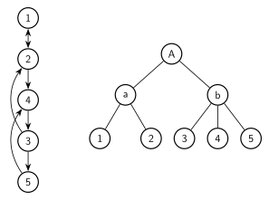

## 定义

有向图上的最小生成树（Directed Minimum Spanning Tree）称为最小树形图．

常用的算法是朱刘算法（也称 Edmonds 算法），可以在 $O(nm)$ 时间内解决最小树形图问题．

## 过程

1.  对于每个点，选择指向它的边权最小的那条边．
2.  如果没有环，算法终止；否则进行缩环并更新其他点到环的距离．

## 实现

```cpp
--8<-- "docs/graph/code/dmst/dmst_1.cpp:core"
```

## Tarjan 的 DMST 算法

Tarjan 提出了一种能够在 $O(m+n\log n)$ 时间内解决最小树形图问题的算法．

这里的算法描述以及参考代码基于 Uri Zwick 教授的课堂讲义，更多的细节可以参考原文．

### 过程

Tarjan 的算法分为 **收缩** 与 **伸展** 两个过程．接下来先介绍 **收缩** 的过程．

我们需要假设输入的图是满足强连通的，如果不满足那么就加入 $O(n)$ 条边使其满足，并且这些边的边权是无穷大的．

我们需要一个堆存储结点的入边编号，入边权值，结点总代价等相关信息，由于后续过程中会有堆的合并操作，这里采用 [左偏树](../ds/leftist-tree.md) 与 [并查集](../ds/dsu.md) 实现．算法的每一步都选择一个任意结点 $v$，需要保证 $v$ 不是根节点，并且在堆中没有它的入边．再将 $v$ 的最小入边加入到堆中，如果新加入的这条边使堆中的边形成了环，那么将构成环的那些结点收缩，我们不妨将这些已经收缩的结点命名为 **超级结点**，再继续这个过程，如果所有的顶点都缩成了一个超级结点，那么收缩过程就结束了．整个收缩过程结束后会得到一棵收缩树，之后将对它进行伸展操作．

堆中的边总是会形成一条路径 $v_0\leftarrow v_1\leftarrow \dots\leftarrow v_k$，由于图是强连通的，这个路径必然存在，并且其中的 $v_i$ 可能是最初的单一结点，也可能是压缩后的超级结点．

最初有 $v_o=a$，其中 $a$ 是图中任意的一个结点，每一次选择一条最小入边 $v_k\leftarrow u$，如果 $u$ 不是 $v_0,v_1,\dots,v_k$ 中的一个结点，那么就将结点扩展到 $v_{k+1}=u$．如果 $u$ 是他们其中的一个结点 $v_i$，那么就找到了一个关于 $v_i\leftarrow\dots\leftarrow v_k\leftarrow v_i$ 的环，再将他们收缩为一个超级结点 $c$．

向队列 $P$ 中放入所有的结点或超级结点，并初始选择任意一节点 $a$，只要队列不为空，就进行以下步骤：

1.  选择 $a$ 的最小入边，保证不存在自环，并找到另一头的结点 $b$．如果结点 $b$ 没有被记录过说明未形成环，令 $a\leftarrow b$，继续当前操作寻找环．

2.  如果 $b$ 被记录过了，就说明出现了环．总结点数加一，并将环上的所有结点重新编号，对堆进行合并，以及结点/超级结点的总权值的更新．更新权值操作就是将环上所有结点的入边都收集起来，并减去环上入边的边权．



以图片为例，左边的强连通图在收缩后就形成了右边的一棵收缩树，其中 $a$ 是结点 1 与结点 2 收缩后的超级结点，$b$ 是结点 3，结点 4，结点 5 收缩后的超级结点，$A$ 是两个超级结点 $a$ 与 $b$ 收缩后形成的．

伸展过程是相对简单的，以原先要求的根节点 $r$ 为起始点，对 $r$ 到收缩树的根上的每一个环进行伸展．再以 $r$ 的祖先结点 $f_r$ 为起始点，将其到根的环展开，直到遍历完所有的结点．

### 实现

```cpp
--8<-- "docs/graph/code/dmst/dmst_2.cpp"
```

## 参考文献

Uri Zwick. (2013),[Directed Minimum Spanning Trees](http://www.cs.tau.ac.il/~zwick/grad-algo-13/directed-mst.pdf), Lecture notes on "Analysis of Algorithms"

<https://riteme.site/blog/2018-6-18/mdst.html#_3>
