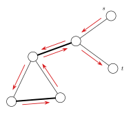
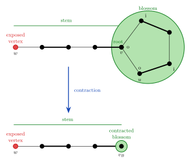
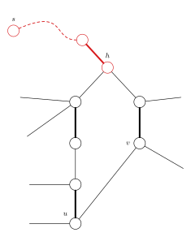
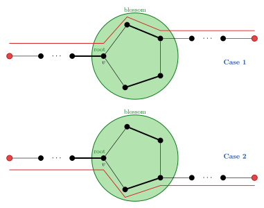

author: H-J-Granger, accelsao, Ir1d, Early0v0, Henry-ZHR, HeliumOI, AntiLeaf, ShizuhaAki, pukui

## 带花树算法（Blossom Algorithm）

开花算法（Blossom Algorithm，也被称做带花树）可以解决一般图最大匹配问题（maximum cardinality matchings）．此算法由 Jack Edmonds 在 1961 年提出．
经过一些修改后也可以解决一般图最大权匹配问题．
此算法是第一个给出证明说最大匹配有多项式复杂度．

一般图匹配和二分图匹配（bipartite matching）不同的是，图可能存在奇环．



以此图为例，若直接取反（匹配边和未匹配边对调），会使得取反后的 $M$ 不合法，某些点会出现在两条匹配上，而问题就出在奇环．

下面考虑一般图的增广算法．
从二分图的角度出发，每次枚举一个未匹配点，设出发点为根，标记为 **「o」**，接下来交错标记 **「o」** 和 **「i」**，不难发现 **「i」** 到 **「o」** 这段边是匹配边．

假设当前点是 $v$，相邻点为 $u$，可以分为以下两种情况：

1.  $u$ 未拜访过，当 $u$ 是未匹配点，则找到增广路径，否则从 $u$ 的配偶找增广路．
2.  $u$ 已拜访过，遇到标记「o」代表需要 **缩花**，否则代表遇到偶环，跳过．

遇到偶环的情况，将他视为二分图解决，故可忽略．**缩花** 后，再新图中继续找增广路．



设原图为 $G$，**缩花** 后的图为 $G'$，我们只需要证明：

1.  若 $G$ 存在增广路，$G'$ 也存在．
2.  若 $G'$ 存在增广路，$G$ 也存在．



设非树边（形成环的那条边）为 $(u,v)$，定义花根 $h=LCA(u,v)$．
奇环是交替的，有且仅有 $h$ 的两条邻边类型相同，都是非匹配边．
那么进入 $h$ 的树边肯定是匹配边，环上除了 $h$ 以外其他点往环外的边都是非匹配边．

观察可知，从环外的边出去有两种情况，顺时针或逆时针．



于是 **缩花** 与 **不缩花** 都不影响正确性．

实作上找到 **花** 以后我们不需要真的 **缩花**，可以用数组纪录每个点在以哪个点为根的那朵花中．

### 复杂度分析 Complexity Analysis

每次找增广路，遍历所有边，遇到 **花** 会维护 **花** 上的点，$O(|E|^2)$．

枚举所有未匹配点做增广路，总共 $O(|V||E|^2)$．

### 参考代码

??? note "参考代码"
    ```cpp
    --8<-- "docs/graph/code/graph-matching/general-match/general-match_1.cpp:core"
    ```

??? note "[UOJ #79. 一般图最大匹配](https://uoj.ac/problem/79)"
    ```cpp
    --8<-- "docs/graph/code/graph-matching/general-match/general-match_2.cpp"
    ```

## 基于高斯消元的一般图匹配算法

???+ tip "提示"
    在阅读以下内容前，你可能需要先阅读「线性代数」部分中关于矩阵的内容：
    
    -   [矩阵](../../math/linear-algebra/matrix.md)
    -   [行列式](../../math/linear-algebra/determinant.md)
    -   [高斯消元](../../math/numerical/gauss.md)

这一部分将介绍一种基于高斯消元的一般图匹配算法．与传统的带花树算法相比，它的优势在于更易于理解与编写，同时便于解决「最大匹配中的必须点」等问题；缺点在于常数比较大，因为高斯消元的 $O(n^3)$ 基本是跑满的，而带花树一般跑不满．

### 前置知识：Tutte 矩阵

**定义**：对于一张 $n$ 个点的无向图 $G = (V, E)$，其 Tutte 矩阵 $\tilde{A}(G)$ 为一个 $n \times n$ 的矩阵，其中：

$$
\tilde{A}(G)_{i,j} = \begin{cases}
x_{i,j}, & i<j,\; (v_i, v_j)\in E \\
-x_{i,j}, & i > j,\; (v_i, v_j) \in E \\
0, & \text{otherwise}
\end{cases}
$$

其中 $x_{i, j}$ 是一个变量，因此 $\tilde{A}(G)$ 中共有 $|E|$ 个变量．

在无歧义的情况下，以下将 $\tilde{A}(G)$ 简写为 $\tilde{A}$．

**定理**（Tutte 定理）：$G$ 存在完美匹配当且仅当 $\det \tilde{A} \ne 0$．

??? note "证明"
    这里引入「偶环覆盖」的概念：一个无向图 $G$ 的偶环覆盖指用若干偶环（包括二元环）不重不漏地覆盖所有的点．
    
    易证 $G$ 存在完美匹配当且仅当 $G$ 存在偶环覆盖．
    
    -   如果 $G$ 存在偶环覆盖，我们只需要在每个环都隔一条取一条边，就可以得到一个完美匹配．
    -   如果 $G$ 存在完美匹配，我们只需要将匹配边对应的二元环取出，就可以得到一个偶环覆盖．
    
    然后证明 $G$ 存在偶环覆盖当且仅当 $\tilde{A} \ne 0$．
    
    考虑行列式的定义
    
    $$
    \det A = \sum_{\pi} (-1)^{\pi} \prod_{i} A_{i, \pi_i}
    $$
    
    其中 $\pi$ 是任意排列，$(-1)^{\pi}$ 表示若 $\pi$ 中的逆序对数为奇数，则取 $-1$，否则取 $1$．
    
    不难看出每个排列都可以被看作 $G$ 的一个环覆盖．如果这个环覆盖中存在奇环，则将这个环翻转后的和一定为 $0$，因此只有偶环覆盖才能使行列式不为 $0$，证毕．

**定理**：$\operatorname{rank}\tilde{A}$ 一定为偶数，并且 $G$ 的最大匹配的大小等于 $\operatorname{rank}\tilde{A}$ 的一半．

??? note "证明"
    反对称矩阵的秩只能是偶数；后者请读者自行思考．

实际应用中不可能带着 $|E|$ 个变量进行计算，不过可以取一个数域，例如取某个素数 $p$ 的剩余系 $\mathcal{Z}_p$，将变量分别随机替换为 $\mathcal{Z}_p$ 中的数，再进行计算．方便起见，在无歧义的情况下，以下用 $\tilde{A}$ 直接指代替换后的矩阵．

**定理**：$\operatorname{rank}\tilde{A}$ 至多为 $G$ 的最大匹配大小的两倍，并且二者相等的概率至少为 $1 - \frac n p$．

考虑到一般图最大匹配中 $n$ 基本不会超过 $10^3$，实际中 $p$ 取 $10^9$ 数量级的素数就足够了．

由定理可知，如果只需要求最大匹配数，而无需匹配方案，那么只需要用一次高斯消元求出 $\operatorname{rank}\tilde{A}$ 即可，远比带花树简洁．不过如果需要输出方案，会稍微复杂一些，需要用到下面介绍的算法．

### 构造完美匹配

由 Tutte 定理和上面的定理可知，如果 $G$ 存在完美匹配，那么 $\tilde{A}$ 有很大概率满秩．方便起见，以下叙述中均省略「有很大概率」．

记 $G$ 中标号为 $i$ 的点为 $v_i$，进一步地我们有如下定理：

**定理**：$\tilde{A}^{-1}_{j,i} \ne 0 \iff G - \{v_i, v_j\}$ 有完美匹配．

???+ tip "逆矩阵与伴随矩阵"
    对任意 $n$ 阶方阵 $A$，定义其伴随矩阵为 $A^*_{i, j} = (-1)^{i + j} M_{j, i}$，其中 $M_{j, i}$ 为删去第 $j$ 行第 $i$ 列的余子式．换言之，设 $A$ 的代数余子式矩阵为 $M$，则 $A^* = M^T$．
    
    **定理**：如果 $A$ 可逆，那么 $A^{-1} = \frac 1 {\det A} A^*$．
    
    所以这里的 $A^{-1}_{j, i} \ne 0 \iff M_{i, j} \ne 0$，也就是 $A$ 删去第 $i$ 行第 $j$ 列后的部分满秩．

换言之，如果 $(v_i, v_j) \in E$，并且 $\tilde{A}^{-1}_{j, i} \ne 0$，就表明存在一个完美匹配方案包含 $(v_i, v_j)$ 这条边．以下将这种边称为 **可行边**．

由如上定理，对于一个有完美匹配的无向图 $G$，我们可以得到一个比较显然的暴力算法来寻找一组完美匹配：每次枚举 $i, j$，如果 $(v_i, v_j)$ 是一条可行边（连边存在，并且 $\tilde{A}^{-1}_{j, i} \ne 0$），就将 $(v_i, v_j)$ 加入匹配方案，并在 $G$ 中都删掉这两个点，再重新计算新的 $\tilde{A}^{-1}$．

总共要做 $\frac n 2$ 轮，每轮都是 $O(n^3)$ 的，总的复杂度是 $O(n ^ 4)$，有点慢了．实际上我们在重新计算 $\tilde{A}^{-1}$ 时，不必每次都重新用高斯消元求逆矩阵，而是可以利用如下定理：

**定理**（消去定理）：令

$$
A = \begin{bmatrix}
  a_{1, 1} & v^T \\
  u & B
\end{bmatrix} \quad A^{-1} = \begin{bmatrix}
  \hat a^{1, 1} & \hat v^T \\
  \hat u & \hat B
\end{bmatrix}
$$

并且 $\hat a_{1, 1} \ne 0$, 那么就有

$$
B^{-1} = \hat B - \frac {\hat u \hat v^T} {\hat a_{1, 1}}
$$

定理中描述的是消去第一行第一列的情况．实际上，它可以非常显然地推广到消去任意一行一列的情况，因此我们只需在算法最开始计算一次 $\tilde{A}^{-1}$，后面每次删除两个点时，只需执行两次 $O(n^2)$ 的消去过程即可．

??? note "描述有些抽象，可以参考 C++ 代码"
    ```cpp
    --8<-- "docs/graph/code/graph-matching/general-match/general-match_3.cpp:core"
    ```

总共要做 $\frac n 2$ 轮，每轮复杂度为 $O(n^2)$，因此上述算法可以在 $O(n^3)$ 的时间内找到一组完美匹配．

### 构造最大匹配

我们刚刚已经解决了构造一组完美匹配的问题，但是求解问题时一般需要最大匹配．

前面已经提到，$G$ 的最大匹配大小等于 $\operatorname{rank}\tilde{A}$ 的一半．如果我们能找到 $\tilde{A}$ 的一个最大满秩子方阵，那么对子方阵对应的导出子图求出一组完美匹配，即可找到 $G$ 的一组最大匹配．

换一个角度考虑，如果 $G$ 有完美匹配，那么 $\tilde{A}$ 满秩，换言之，$\tilde{A}$ 是线性无关的．那么如果 $\tilde{A}$ 不是满秩的，我们可以求出 $\tilde{A}$ 的一组线性基，然后只保留线性基对应的行列，就可以得到 $\tilde{A}$ 的一个最大满秩子方阵．

求出最大满秩子方阵之后，再用上面的算法找出导出子图的一组完美匹配，即可得到原图的一组最大匹配．注意由于高斯消元中可能会有行的交换，因此实现时要注意维护好点的编号．

??? note "[UOJ #79. 一般图最大匹配](https://uoj.ac/problem/79)"
    ```cpp
    --8<-- "docs/graph/code/graph-matching/general-match/general-match_4.cpp"
    ```

## 习题

-   [UOJ #79. 一般图最大匹配](https://uoj.ac/problem/79)
-   [UOJ#171.【WC2016】挑战 NPC](https://uoj.ac/problem/171)

## 参考资料

1.  Mucha M, Sankowski P.[Maximum matchings via Gaussian elimination](http://web.eecs.umich.edu/~pettie/matching/Mucha-Sankowski-maximum-matching-matrix-multiplication.pdf)
2.  周子鑫，杨家齐《基于线性代数的一般图匹配》
3.  ZYQN [《基于线性代数的一般图匹配算法》](https://oi.cyo.ng/wp-content/uploads/2017/02/maximum_matchings_via_gaussian_elimination.pdf)
