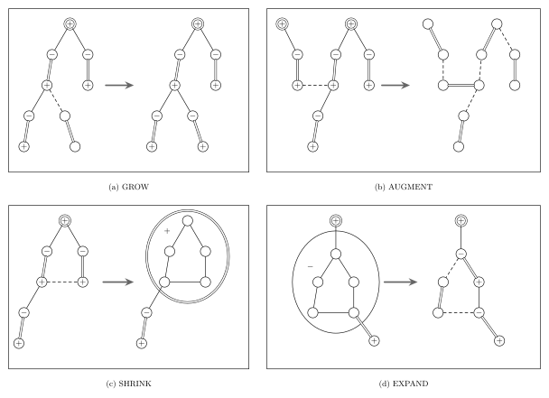
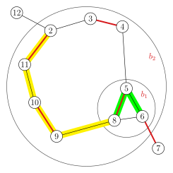
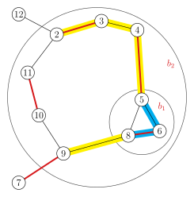

author: accelsao, Henry-ZHR, yuhuoji

本页从一般图最大权完美匹配到一般图最大权匹配（最大权匹配可以通过增加零边变成最大权完美匹配）．

## 预备知识

### 花（blossom）

一般图匹配和二分图匹配不同的是，图可能存在奇环．可以将偶环视为二分图．

带花树算法（Blossom Algorithm）的处理方式时是遇到奇环就把它缩成一个 **花（Blossom）**，并把花中所有的点设为偶点．既然花上的点都可以成为偶点，那么可以把整个花直接缩成一个偶点．注意，一个花可以包含其它花．

这也可以变成线性规划和对偶问题，但是要对花进行一些处理．

### 顶标（vertex labeling）和等边（Equality Edge）

定义 $z_u$ 是点 $u$ 的顶标（vertex labeling），与 $KM$ 算法中定义的顶标含义相同．定义边 $e(u,v)$ 为 "等边" 当且仅当点 $u$ 和点 $v$ 的标号和等于边 $e$ 的权值（$z_u + z_v = w(e)$），此时边的标号 $z_e = z_u + z_v − w(e) = 0$．

## 一般图最大权完美匹配的线性规划

### 定义

因为一朵花最少有三个点，缩花后成为一个点．设 $O$ 为大小为 $≥3$ 奇数的集合的集合（包含所有花），$\gamma(S)$ 表示 $S$ 集合中的边．

$$
\begin{aligned}
& \text{设} S\subseteq V \\
& \gamma(S)=\{(u,v)\in E:u\in S,v\in S\} \\
& O=\{B\subseteq V:|B|\text{是奇数且}|B|\geq3\} \\
\end{aligned}
$$

### 对偶问题

???+ note "原问题"
    $$
    \begin{aligned}
    & \max\sum_{e\in E}w(e)x_e \\
    & \text{限制：} \\
    & x(\delta(u))=1:\forall u\in V \\
    & x(\gamma(B))\leq\lfloor\frac{|B|}{2}\rfloor:\forall B\in O \\
    & x_e\geq0:\forall e\in E \\
    \end{aligned}
    $$

然后通过原始对偶（Primal-Dual）将问题转换为对偶问题．

???+ note "对偶问题"
    $$
    \begin{aligned}
    & \min\sum_{u\in V}z_u+\sum_{B\in O}\left\lfloor\frac{|B|}{2}\right\rfloor z_B \\
    & \text{限制：} \\
    & z_B\geq0:\forall B\in O \\
    & z_e\geq0:\forall e\in E \\
    & \text{设} e=(u,v)，\text{这里} \\
    & \begin{array}{lll}
    z_e & = & z_u + z_v - w(e) + \sum_{\substack{B \in O \\ u,v \in \gamma(B)}} z_B
    \end{array}
    \end{aligned}
    $$

$x_e=1$ 的边是匹配边，$x_e=0$ 的边是非匹配边．和二分图一样，我们必须满足 $x_e\in\{0,1\}:\forall e\in E$．因此必须在最大权完美匹配的时候，让所有匹配边都是 **等边** 的．

和二分图不同的是，一般图多了 $z_B$ 要处理．下面考虑 $z_B$ 什么时候大于 $0$．

可以看出，尽量使 $z_B=0$ 是最好的做法，但在不得已时还是要让 $z_B>0$．在 $x(\gamma(B)) = \left\lfloor \dfrac{|B|}2 \right\rfloor \text{且} x(\delta(B)) = 1$ 时，让 $z_B>0$ 即可．因为除了在这种情况下，$z_B>0$ 是无意义的．

根据互补松弛条件，有以下的对应关系：

-   对于选中的边 $e$，必有 $z_e=0$．

    $$
    x_e>0 \longrightarrow z_e=0,\quad \forall e\in E
    $$

-   对于选中的集合*B*，$z_B>0 \longrightarrow x(\gamma(B))= \left\lfloor \dfrac{|B|}2 \right\rfloor$，即所有 $z_B>0$ 的集合 $B$，都被选了集合大小一半的边，也即集合 $B$ 是一朵花，选中花中的一条边进行增广．同时，我们加入一个条件：$x(\delta(B))=1$，即只有花 $B$ 向外连了一条边的时候，$z_B>0$ 才是有意义的．

    $$
    z_B>0 \longrightarrow x(\gamma(B))=\left\lfloor\frac{|B|}2\right\rfloor, x(\delta(B))=1\quad \forall B\in O
    $$

以「**等边**」的概念，结合之前的带花树算法：用「等边」构成的增广路不断进行扩充，由于用来扩充的边全是「等边」，最后得到的最大权完美匹配仍然全是「等边」．

### 处理花的问题

当遇到花的时候，要将它缩成一个偶点．将花中所有点都设为偶点，并让它的 $z_B=0$．

由于缩花后会把花保存起来，直到满足某些条件才会拆开，所以不能用之前的方法记录花．

如果没有特殊说明，之前提到的点，都包含缩花形成的偶点．

由于花也有可能缩成点被加入队列中，并且花的数量是不固定的，因此不能像之前一样枚举每个点来检查是否有增广路．因此，在进行广度优先搜索（BFS）时，必须将所有未匹配的点都放入队列中．

这样会同时产生很多棵交错树．

### 算法的四个步骤

这个算法可以分成四个步骤．

1.  GROW（等边）：用 "等边" 构成交错树．
2.  AUGMENT（增广）：找出增广路并扩充匹配．
3.  SHRINK（缩花）：把花缩成一个点．
4.  EXPAND（展开）：把花拆开．



在 AUGMENT 阶段时，因为所有未匹配点都会在不同的交错树上，所以当增广时两棵交错树的偶点连在一起，就表示找到了一条增广路．

### 找不到等边扩充

和二分图一样，也会有找不到「等边」扩充的问题．这时就需要调整 vertex labeling．

### 调整 VERTEX LABELING

vertex labeling 仍要维持大于等于的性质，而且既有的「等边」不能被改变，还要让 $z_B$ 尽量的小．

???+ note "定义符号 奇偶点"
    以 $u^−$ 来表示 $u$ 在交错树上为奇点．  
    以 $u^+$ 来表示 $u$ 在交错树上为偶点．  
    以 $u^\varnothing$ 来表示 $u$ 不在任何一棵交错树上．  
    之后所有提到的 $B$ 预设都是花，并同时代表缩花之后的点．  
    花也可以有奇花偶花之分，因此也适用 $B^+$、$B^−$、$B^\varnothing$ 等符号．

设目前有 r 棵交错树 $T_i=(U_{t_i},V_{t_i}):1\leq i\leq r$，令

$$
\begin{aligned}
d1 &= \min(\{z_e : e = (u^+,v^\varnothing)\}) \\
d2 &= \min(\{z_e : e = (u^+,v^+), ~ u^+ \in T_i, ~ v^+ \in T_j, ~ i \neq j\}) / 2 \\
d3 &= \min(\{z_{B^-} : B^- \in O\}) / 2
\end{aligned}
$$

注意这里*B*是缩花之后的点，所以可以有奇偶性．

设 $d=min(d1,d2,d3)$，让

$$
\begin{aligned}
z_{u^+} - &= d \\
z_{v^-} + &= d \\
z_{B^+} + &= 2d \\
z_{B^-} - &= 2d \\
\end{aligned}
$$

如果出现 $z_B=0(d=d3)$，为了防止 $z_B<0$ 的情况，所以要把这朵花拆了 (EXPAND)．
拆花后只留下花里的交替路径，并把花里不在交替路径上的点设为未走访 ($\varnothing$)．

如此便制造了一条（以上）的等边，既有等边保持不动，并维持了 $z_e\geq0:\forall e\in E$ 的性质，且最低限度增加了 $z_B$，可以继续找增广路了．

## 一般图最大权匹配

以上求的是最大权完美匹配，求最大权匹配需要在 vertex labeling 额外增加一个限制：对于所有匹配点 $u$，$z_u>0$．

开始时先设所有的 $z_u=max(\{w(e):e\in E\})/2$．

vertex labeling 为 $0$ 的点最后将成为未匹配点．

### 参考代码

这里为了方便实现，使用边权乘 $2$ 来计算 $z_e$ 的值，这样就不会出现浮点数误差了．

???+ note "存储"
    ```cpp
    --8<-- "docs/graph/code/graph-matching/general-weight-match/general-weight-match_1.cpp:types"
    ```

下面是嵌套花的例子．



其中 $\{ 6, 5, 8\} \in b1,\{ b1, 4, 3, 2, 11, 10, 9\} \in b2$．存储为：

```text
flower[b2] = {b1, 4, 3, 2, 11, 10, 9} 
flower[b1] = {6, 5, 8}
```



```text
flower[b2] = {9, b1, 4, 3, 2, 11, 10} 
flower[b1] = {5, 8, 6}
```

```cpp
--8<-- "docs/graph/code/graph-matching/general-weight-match/general-weight-match_1.cpp:state"
```


```text
flower_from[b2][6] = b1 
flower_from[b2][5] = b1 
flower_from[b2][9] = 9 
flower_from[b1][6] = 6 
以此类推
```

```cpp
--8<-- "docs/graph/code/graph-matching/general-weight-match/general-weight-match_1.cpp:slack"
```

```cpp
--8<-- "docs/graph/code/graph-matching/general-weight-match/general-weight-match_1.cpp:queue"
```

```cpp
--8<-- "docs/graph/code/graph-matching/general-weight-match/general-weight-match_1.cpp:order"
```


如果使用 `get_pr(b2,11)`，`flower[b2]` 会变成 `{9,10,11,2,3,4,b1}`，并返回 2．

如果使用 `get_pr(b2,2)`，`flower[b2]` 会变成 `{9,b1,4,3,2,11,10}`，并返回 4．

```cpp
--8<-- "docs/graph/code/graph-matching/general-weight-match/general-weight-match_1.cpp:augment"
```

???+ note "增加一朵奇花"
    ```cpp
    --8<-- "docs/graph/code/graph-matching/general-weight-match/general-weight-match_1.cpp:contract"
    ```

???+ note "拆花"
    ```cpp
    --8<-- "docs/graph/code/graph-matching/general-weight-match/general-weight-match_1.cpp:expand"
    ```

???+ note "尝试增广一条等边"
    ```cpp
    --8<-- "docs/graph/code/graph-matching/general-weight-match/general-weight-match_1.cpp:edge"
    ```

???+ note "增广"
    ```cpp
    --8<-- "docs/graph/code/graph-matching/general-weight-match/general-weight-match_1.cpp:search"
    ```

???+ note "主函数"
    ```cpp
    --8<-- "docs/graph/code/graph-matching/general-weight-match/general-weight-match_1.cpp:solve"
    ```

???+ note "初始化"
    很重要 使用前一定要初始化
    
    ```cpp
    --8<-- "docs/graph/code/graph-matching/general-weight-match/general-weight-match_1.cpp:initialize"
    ```

## 复杂度分析

每朵花在一次 BFS 中只会被缩花或拆花一次．每次缩花或拆花的时间复杂度为 $O(|V|)$．最多总共有 $O(|V|)$ 朵花，所以花的处理花费 $O(|V|^2)$ 的时间．而 BFS 花费 $O(|V| + |E|)$ 的时间复杂度．因此，找增广路花费 $O(|V| + |E|) + O(|V|^2) = O(|V|^2)$ 的时间复杂度．

最多做 $|V|$ 次 BFS．所以，总时间复杂度为 $O(|V|^3)$．

## 习题

-   [UOJ #81. 一般图最大权匹配](https://uoj.ac/problem/81)

## 参考资料

1.  [Kolmogorov, Vladimir (2009), "Blossom V: A new implementation of a minimum cost perfect matching algorithm"](http://pub.ist.ac.at/~vnk/papers/BLOSSOM5.html)
2.  [从匈牙利算法到带权带花树——详解对偶问题在图匹配上的应用](https://www.luogu.com.cn/blog/potassium/solution-p6699)
